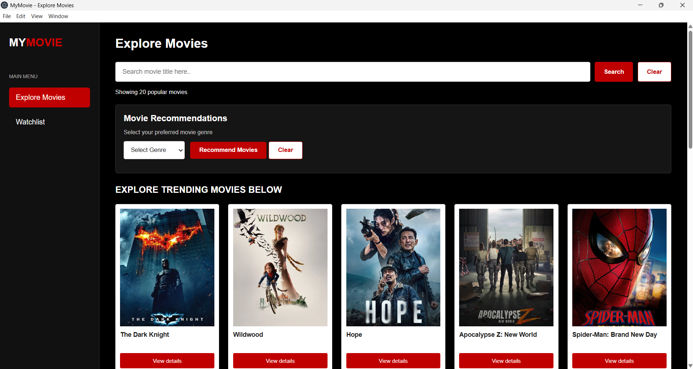
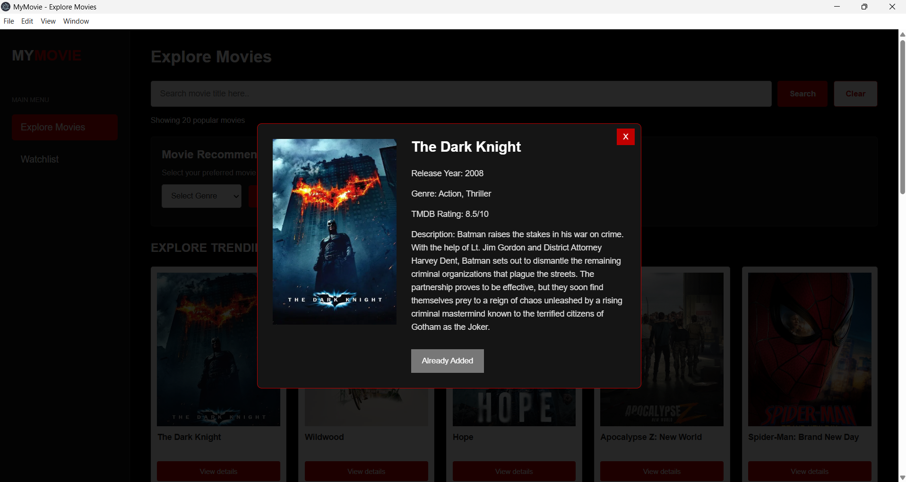
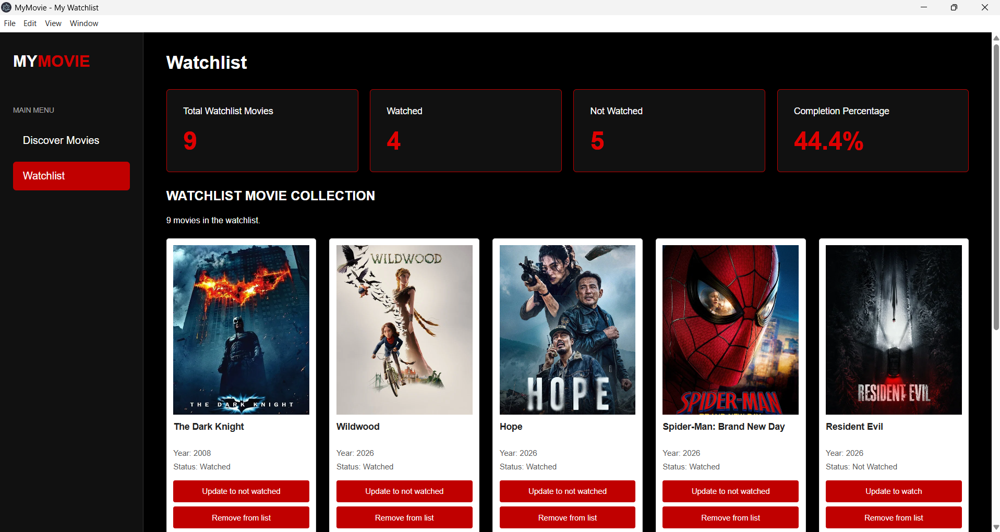

# MyMovie – Movie Discovery and Watchlist Application

## 1. Project Overview

MyMovie is an Electron based desktop application developed to help users discover movies, explore different movie genres, view movie information and manage their personal movie watchlists.

The application retrieves movie information from The Movie Database (TMDB) API and allows users to organise their selected movies through a simple and user-friendly interface.

## 2. Features and Functionalities

### Movie Discovery
- Display popular movies automatically when the application opens.
- Search movies by title.
- Display movie posters and movie titles.
- View detailed movie information, including release year, genre, rating and description.

### Movie Recommendations
- Select a preferred movie genre.
- Receive movie recommendations based on the selected genre.
- Supports Action, Adventure, Comedy, Horror, Thriller, Sci-Fi and Romance.

### Personal Watchlist
- Add movies to a personal watchlist.
- Update movie watching status.
- Remove movies from the watchlist.
- Store watchlist records using Local Storage.

### Movie Statistics
- Calculate total movies in the watchlist.
- Count watched and unwatched movies.
- Calculate movie completion percentage.

## 3. Technologies Used
- HTML – Application structure.
- CSS – User interface and styling.
- JavaScript – Application functionality and logic.
- Electron – Desktop application framework.
- TMDB API – External movie information.
- JSON – Movie data processing.
- Local Storage – Watchlist data storage.
- GitHub – Source code repository.

## 4. Project Structure
```text
MyMovie/
├── main.js
├── index.html
├── watchlist.html
├── renderer.js
├── watchlist.js
├── style.css
├── config.example.js
├── package.json
├── package-lock.json
├── .gitignore
└── README.md
```
## 5. Installation and Setup
### Requirements
- Node.js and npm
- Git
- TMDB API Key (v3)

### Step 1: Clone the Repository
```bash
git clone https://github.com/NURELYIANADALILA/mymovie-oop-project.git
```
### Step 2: Open the Project Folder
```bash
cd mymovie-oop-project
```
### Step 3: Install Dependencies
```bash
npm install
```
### Step 4: Configure TMDB API Key
1. Copy `config.example.js`.
2. Rename the copied file to `config.js`.
3. Open `config.js`.
4. Replace the placeholder with your own TMDB API Key.
Example:
```javascript
const API_KEY = 'YOUR_TMDB_API_KEY';
module.exports = API_KEY;
```
### Step 5: Run the Application
```bash
npm start
```
## 6. Screenshots
### Discover Movies

### Movie Details

### My Watchlist

## 7. API Attribution
Movie information is retrieved from [The Movie Database (TMDB)](https://www.themoviedb.org/).
This product uses the TMDB API but is not endorsed or certified by TMDB.
## 8. GitHub Repository
Repository URL:
https://github.com/NURELYIANADALILA/mymovie-oop-project
---
**Project:** MyMovie – Movie Discovery and Watchlist Application  
**Developer:** Nur Elyiana Dalila  
**Framework:** Electron  
**API:** The Movie Database (TMDB)